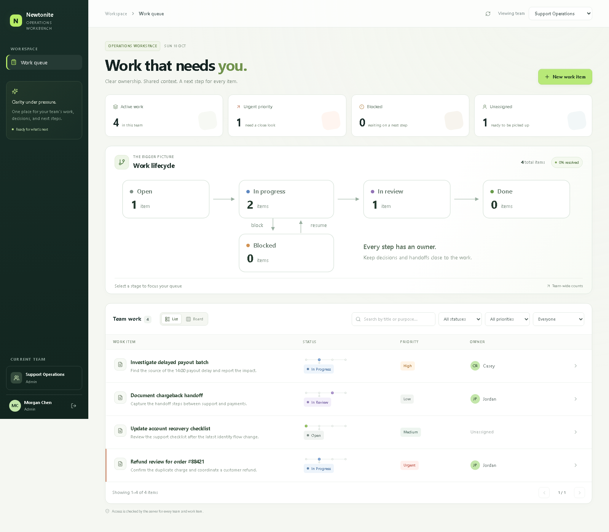
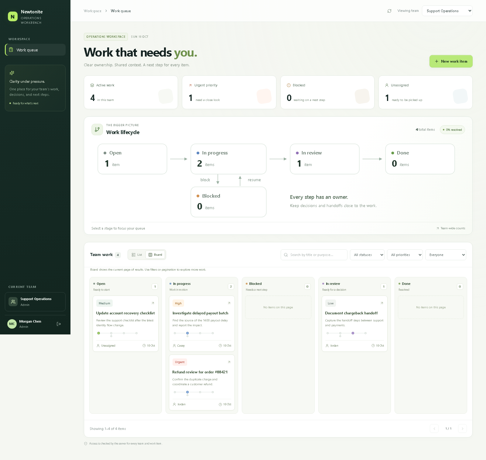
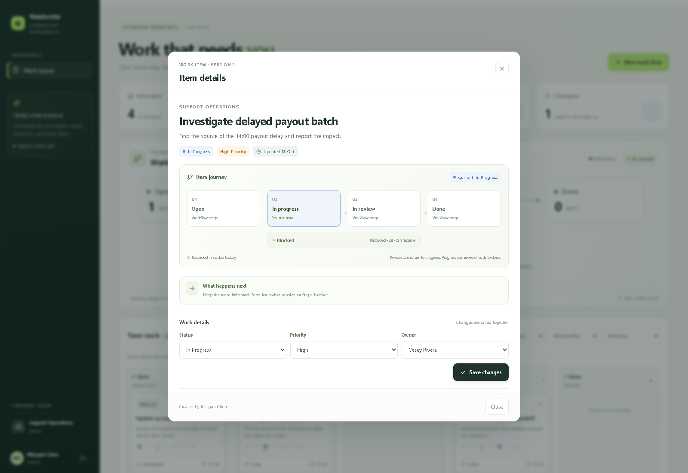

# Newtonite Workbench

Newtonite Workbench is a team operations queue with a Next.js web app, FastAPI service, PostgreSQL database, Redis-backed sign-in throttling, and Caddy ingress. The API remains the authorization boundary for team membership and work-item changes.

Built for **Newtonite — Operations Under Pressure**. The focus is reliable ownership, understandable history, and safe concurrent changes.

**Documentation:** [User and developer workflows](workflow.md) · [Engineering decisions and trade-offs](ENGINEERING_DECISIONS.md) · [Known limitations](#known-limitations) · [Requirement coverage](#challenge-coverage)



<details>
<summary>Preview the workflow board and item journey</summary>

The board uses the same server-paginated results as the list. The item journey highlights the current stage and visits recorded in the loaded history.





</details>

## Reviewer quick start

The Docker route runs the complete PostgreSQL/Redis application. Install and start Docker Desktop (or Docker Engine with Compose), then run these commands in the repository root:

```powershell
Copy-Item .env.example .env
```

Edit `.env` and replace all three `CHANGE_ME` values: `POSTGRES_PASSWORD`, `REDIS_PASSWORD`, and `SESSION_SECRET`. Generate a separate value for each with `python -c "import secrets; print(secrets.token_urlsafe(48))"`; use at least 64 characters for the session secret. Keep `PUBLIC_HOST=:8080` and `COOKIE_HTTPS_ONLY=false` for this local reviewer run.

```powershell
docker compose up --build -d
docker compose exec api python -m app.cli seed-demo
docker compose ps
```

Open [http://localhost:8080/login](http://localhost:8080/login), select a demo account tile, and sign in. On Linux/macOS use `cp .env.example .env` for the first command. No paid service, email verification, or external account is required. The first build takes longer while dependencies and container images download. Run `docker compose logs api web caddy` if startup fails.

For a five-minute demonstration: sign in as Morgan, switch to Support Operations, select a status in the workflow overview, open an item and inspect its history, then create and claim an item. Open a second browser session as Jordan to demonstrate a stale edit or claim conflict. The [workflow guide](workflow.md) explains the expected results and the automated test visualization.

To stop the stack while retaining data, use `docker compose down`. Database volumes persist across restarts; `docker compose down --volumes` deliberately deletes this stack's local database.

## Product features

- Team overview counts and server-side search, filters, and pagination.
- Interactive team workflow map with live status counts and click-to-filter queue navigation.
- Queue and status-board views of the same filtered, paginated work.
- Compact current-status graphics and a detailed per-item diagram backed by actual loaded history.
- Live workspace clock with the browser's timezone; clear created, updated, activity, and recorded workflow-stage timestamps.
- Optional due dates and times on work items, with due-soon and overdue indicators across the queue, board, and details.
- Responsive layouts, keyboard-accessible dialogs, and an explicit next-action description for each status.
- Team-scoped roles (`member`, `lead`, `admin`) enforced on API requests.
- Signed, HTTP-only session cookies and salted PBKDF2 password hashes.
- Atomic claims, optimistic version checks, and guarded status transitions.
- Retry-safe work-item creation with per-user idempotency keys.
- Comments and work-item changes in an append-only activity history.
- Loading, empty, validation, permission, conflict, and error feedback in the UI.

### Dates, times, and deadlines

The workspace clock and item timestamps use your browser's local timezone. Create an item with an optional due date and time; its owner or a team lead/admin can change or clear the deadline in details. Local form values are converted to UTC for the API. API datetime inputs must include a UTC offset (for example, `2026-10-19T12:00:00+05:30`); stored values are normalized to UTC.

Active work due within the next 24 hours is **Due within 24h**; an active item past its deadline is **Overdue**. Completed items are exempt from these warnings. Filter the queue or board by **Overdue**, **Due within 24h**, **With due date**, or **No due date**; these filters run on the server before pagination. Overdue and due-within-24-hours results refresh every 60 seconds while selected; relative labels and warnings recalculate every 30 seconds, and the clock ticks each second. Deadline edits use the same permissions, version checks, and transactional activity history as other item edits. No reminders or background jobs are scheduled.

## Local development

Requirements: Python 3.11+, Node.js 20+, and npm. SQLite is used for a quick local run.

### Start the API

```powershell
cd backend
python -m venv .venv
.\.venv\Scripts\Activate.ps1
python -m pip install -r requirements-dev.txt
Copy-Item .env.example .env
python -m alembic upgrade head
uvicorn app.main:app --reload --port 8000 --env-file .env
```

For a new local database, `alembic upgrade head` creates the schema. If you already have a database from the first challenge version, back it up and mark its existing schema once with `python -m alembic stamp 0001_initial`; do not run the initial migration against tables that already exist. With `SEED_DEMO_DATA=true`, the development server adds missing reviewer accounts, teams, and sample work while preserving existing account passwords and work-item changes.

After updating this project, run `python -m alembic upgrade head` from `backend/` before restarting the local API. Migration `0003_deadlines` (`0003_work_item_deadlines.py`) adds a nullable `due_at` column, so existing items keep no deadline until one is set. For an existing Docker installation, back up the database and run `docker compose up --build -d`; the API entrypoint applies pending migrations before serving requests.

API health and readiness are available at `http://localhost:8000/api/health/live` and `http://localhost:8000/api/health/ready`. Interactive API docs are available at `http://localhost:8000/docs` in development.

### Start the web app

In another terminal:

```powershell
cd frontend
npm ci
Copy-Item .env.local.example .env.local
npm run dev
```

Open `http://localhost:3000`.

### Demo sign-in

| Account | Password | Access |
| --- | --- | --- |
| `morgan@newtonite.local` | `Morgan2026!` | Admin in Support Operations; lead in Payments |
| `jordan@newtonite.local` | `Jordan2026!` | Lead in Support Operations |
| `casey@newtonite.local` | `Casey2026!` | Member in Support Operations |
| `taylor@newtonite.local` | `Taylor2026!` | Member in Payments |

These shared credentials are for the Newtonite challenge reviewer environment. To add the demo accounts and sample workspace to an existing database (including one that already has an administrator), run:

```powershell
docker compose exec api python -m app.cli seed-demo
```

The command adds missing accounts and preserves passwords for any matching accounts that already exist. To deliberately restore the documented demo passwords for those four accounts, run `docker compose exec api python -m app.cli seed-demo --reset-passwords`. This resets only the four named demo accounts. Demo seeding remains disabled during normal production startup; use the command only in the isolated evaluation environment.

## Production-style self-hosted deployment

The Compose stack contains PostgreSQL 17, Redis 7, the API, the standalone Next.js server, and Caddy. The database and Redis have persistent volumes and are not published to the host. Caddy is the only public entry point; it routes `/api/*` to FastAPI and the rest to Next.js. With a public DNS name, Caddy obtains and renews TLS certificates automatically.

1. Install Docker Desktop or Docker Engine with the Compose plugin and start its engine.
2. Copy `.env.example` to `.env` in the repository root. Replace the PostgreSQL password, Redis password, and session secret with separate random values. URL-safe values avoid escaping problems in the database connection string. For example:

   ```powershell
   python -c "import secrets; print(secrets.token_urlsafe(48))"
   ```

3. For local HTTP, leave `PUBLIC_HOST=:8080` and `COOKIE_HTTPS_ONLY=false`. For a public deployment, set `PUBLIC_HOST` to a DNS name pointed at the host, set `COOKIE_HTTPS_ONLY=true`, and allow inbound TCP ports 80 and 443 (plus UDP 443 for HTTP/3).
4. From the repository root, start the stack:

   ```powershell
   docker compose up --build -d
   docker compose ps
   docker compose logs -f api caddy
   ```

5. Create the first production administrator. The command prompts for the password without echoing it. Production does not create demo accounts during startup; an isolated challenge environment can add reviewer accounts with the `seed-demo` command documented above:

   ```powershell
   docker compose exec api python -m app.cli bootstrap-admin --email admin@example.com --full-name "Operations Admin" --team "Operations"
   ```

The app is available at `http://localhost:8080` for local use or `https://<PUBLIC_HOST>` with a configured public domain. The API applies pending Alembic migrations before starting. It exposes liveness and readiness checks at `/api/health/live` and `/api/health/ready`; readiness checks PostgreSQL and Redis. Production API docs are disabled.

To add another account, use the CLI command on the API container; it prompts for a password and adds the account to a team with the selected role:

```powershell
docker compose exec api python -m app.cli add-member --email person@example.com --full-name "Team Member" --team "Operations" --role member
```

Available roles are `member`, `lead`, and `admin`. Account recovery and invitations by email are not built in; use your organization’s identity provider or secure provisioning process before exposing the app broadly.

## Database operations

Back up the running PostgreSQL database to a timestamped custom-format dump and SHA-256 sidecar:

```powershell
python scripts/backup_postgres.py
```

The restore script verifies the backup's SHA-256 sidecar before using it. Choose the intended target carefully: restore replaces matching database objects and requires the explicit flag:

```powershell
python scripts/restore_postgres.py backups\newtonite-<timestamp>.dump --confirm-overwrite
```

Copy backups off the host and test restores regularly. The scripts do not schedule backups or encrypt backup files; configure protected off-host storage and retention to match your organization’s recovery targets. Schema changes belong in a new Alembic revision under `backend/migrations/versions/`; the API applies migrations at startup in the single-instance Compose setup.

## Checks and automation

Backend checks:

```powershell
cd backend
python -m pip install -r requirements-dev.txt
python -m pytest -q
```

Frontend checks:

```powershell
cd frontend
npm ci
npm run typecheck
npm run build
npm audit --audit-level=high
```

Chromium browser scenarios use Playwright against a separate disposable PostgreSQL/Redis Compose project. They start and remove that project's database automatically:

```powershell
cd frontend
npm ci
npx playwright install chromium
npm run e2e
npm run e2e:report
```

The suite opens independent Chromium contexts for different employees and covers all demo-account logins and roles, a simultaneous claim race, stale-edit rejection through the UI, member authorization in both UI and API, and duplicate item creation with an idempotency key. It also checks workflow filtering and queue/board consistency, actual visited-state graphics, phone layouts, and modal keyboard access.

For a guided test explorer with selectable scenarios and live steps, run `npm run e2e:ui`. Each HTML report scenario includes a minimalist SVG journey, named steps, browser screenshots, and selected API outcomes. Failures retain actor-specific screenshots, videos, and traces; recording begins after sign-in so password entry is excluded. Run `npm run e2e:report` after the suite to open the visual report; press Ctrl+C to stop its local server. These commands use the isolated E2E database and do not alter the reviewer workspace. If a run is interrupted, `npm run e2e:down` removes only the dedicated `newtonite-e2e` test stack and its database volume.

Reports and traces can contain session/network data. Generated reports stay out of Git; CI uploads only artifacts from the disposable, seeded test environment. Do not publish traces captured against an environment containing real users or operations.

When Docker Desktop is unavailable, `npm run e2e:local` runs the same Chromium scenarios against an isolated SQLite database and removes the temporary database and local API/frontend processes afterward. It generates the same visual report; follow it with `npm run e2e:report`. Use `npm run e2e` for PostgreSQL concurrency verification.

GitHub Actions runs the API checks, applies migrations to PostgreSQL, audits dependencies, checks and builds the frontend, validates Compose, builds production containers, and runs the Chromium suite. The `chromium-test-journey` artifact retains the HTML report and available failure evidence for 14 days.

## Challenge coverage

| Challenge concern | Implementation and review evidence |
| --- | --- |
| Understand the work, its importance, owner, state, and next action | Purpose, priority, owner, explicit statuses, optional deadlines with timing indicators, overview counts, per-item graphical workflow, and timestamped activity history. |
| Multiple teams and responsibilities | Membership-scoped `member`, `lead`, and `admin` roles; Morgan demonstrates different roles across two teams. |
| Enforced authorization | API membership checks on reads and writes; owners and elevated roles have distinct mutation permissions; other teams' items return 404. |
| Simultaneous claims | Conditional SQL update requiring no owner and the expected version; exactly one winner and one claim event. |
| Stale information | Versioned compare-and-set updates return 409; UI refreshes the latest server state and asks the user to review it. |
| Repeated requests | User-scoped idempotency keys and a stored response make repeated item creation safe; changed payloads with the same key return 409. |
| Workflow correctness | API transition rules reject invalid state changes; completed work cannot reopen. |
| Collaboration and traceability | Creation, claims, changes, and comments record actor, time, and details in the same database transaction as the change. |
| Search and growth | SQL-side search/filter/count/pagination, bounded page sizes, compound indexes, and PostgreSQL connection pooling. |
| Dangerous behavior tested | API tests plus isolated Chromium sessions cover claim races, stale edits, authorization, workflow validation, filtering, and retry safety. |
| Setup and operational reasoning | Versioned migrations, production container builds, CI, health checks, JSON request logs, backup/restore tools, and documented trade-offs. |
| Asynchronous secondary effects | Deliberately omitted: primary actions are transactional and no notification worker can lose or duplicate a primary update. See decision 5. |

The brief offers examples of correctness problems rather than a fixed list of optional features. This implementation addresses several of those problems explicitly. `in_review` provides a review stage; it does not implement a separate regulated approval or separation-of-duties policy.

## Known limitations

- The Compose file is a single-host deployment foundation. For multi-host availability, use managed PostgreSQL/Redis or an orchestrator, external secret management, and a deployment system that runs migrations once before rolling out API replicas.
- TLS is automatic only when the configured public DNS name resolves to this host and ports 80/443 are reachable. Local `:8080` mode is plain HTTP.
- Authentication currently uses locally managed passwords and signed sessions. SSO, invitation/password recovery, and a team administration UI require an identity provider and organization-specific policy.
- Health checks and container logs are included; centralized log retention, metrics dashboards, paging, and load/capacity tests must be attached to the target hosting platform.
- Search is case-insensitive substring matching. Larger PostgreSQL deployments should add full-text or trigram search indexes based on observed query load.
- There is no dedicated approval policy, notification worker, email delivery, attachment upload, or comment editing/deletion. Notes and the review stage support coordination, with the decision recorded in the history.
- Timezone follows the OS/browser; there is no timezone selector. Local warnings use the browser clock, while deadline filters use server time. At daylight-saving changes, a newly entered repeated autumn time chooses the earlier occurrence, and a nonexistent spring time is rejected. Saving other fields preserves an unchanged deadline's exact instant. Deadlines do not trigger scheduled notifications, escalations, or automatic status changes.
- The browser refreshes after actions and explicit refreshes. Push updates, live presence, automatic merge of conflicting edits, and offline operation are not implemented.
- Offset pagination and substring search are deliberately simple; very deep queues need keyset pagination, measured search indexes, and load testing before claiming the target concurrency is proven.
- The application retains audit and idempotency rows indefinitely; archival, retention policy, and disaster-recovery targets remain deployment decisions.
- Details start with the latest 100 history events and load older pages on demand. The item graphic reflects loaded history; an earlier visit may appear after an older page is loaded.

## Public repository submission

Submit the **public GitHub repository URL**, with source, this README, [ENGINEERING_DECISIONS.md](ENGINEERING_DECISIONS.md), [workflow.md](workflow.md), and automated tests committed. Open the repository URL in a signed-out/private browser window and confirm the files are visible without requesting permission. A local folder or a running localhost URL is not a public repository.

Before publishing, inspect `git status --short` and `git diff --cached`. `.gitignore` excludes environment secrets, local administrator credentials, databases, backups, generated reports, and the personal preparation documents in this workspace. Commit the `.env.example` templates and lockfile. Public demo passwords in this README are intentional reviewer fixtures; use fresh credentials and disable demo seeding for a real deployment.
