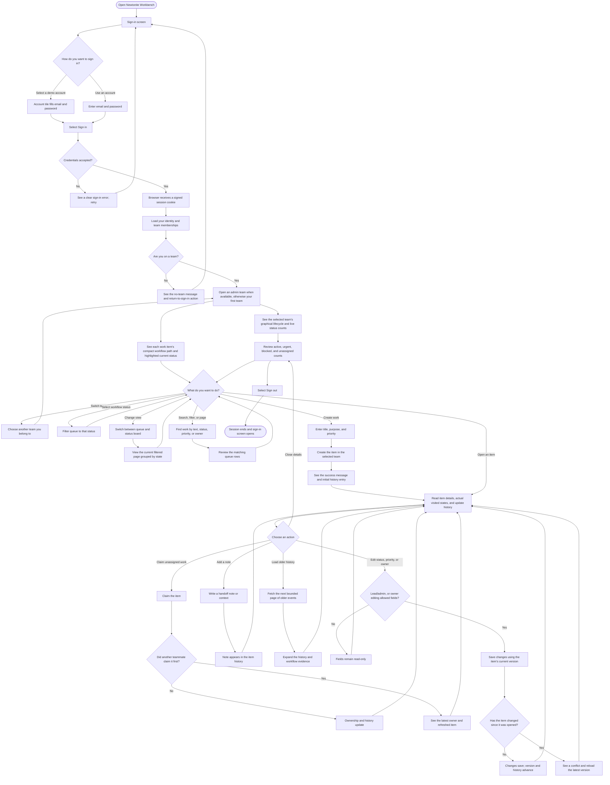
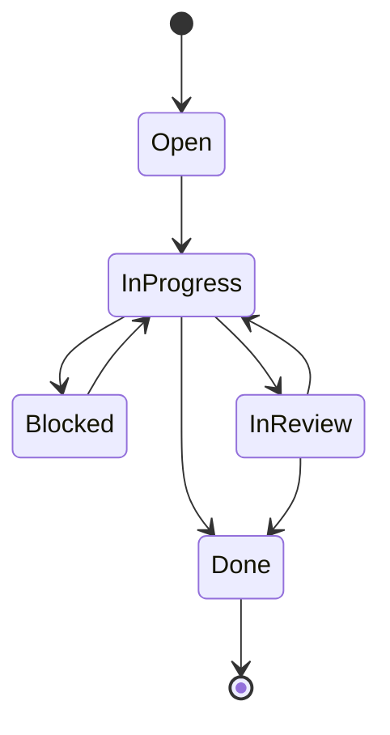
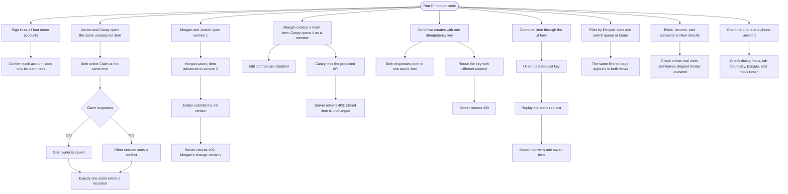

# Newtonite Workbench workflows

This guide follows the running application from the perspective of a team member and then follows the code and data from browser request to database. The diagrams describe the current implementation in this repository.

## 1. User workflow

### What each role can do

| Team role | User-visible access |
| --- | --- |
| Member | View team work, create items, add notes, claim unassigned work, and update status or priority on items they own. |
| Lead | Member actions, plus update status or priority on team items and reassign them to team members. |
| Admin | Same work-item editing and reassignment ability as a lead for that team. |

The server checks membership and role on every protected request. Disabling a control in the browser is only a usability aid; it is not the authorization boundary.

### Work status path

Completed work is terminal. An unassigned, non-completed item can be claimed by a team member. If two people claim at once, the database update allows one winner and the other person receives a conflict response.

The team diagram counts all work in the selected team. Queue and board views apply the same server-side filters and pagination; a board column's visible card count describes the current page, not every item in the team. Selecting a card opens the same item details and permission checks as the queue. The board supports browsing; moving work follows the status control in item details.

The compact row graphic marks the current status. The expanded item diagram uses actual loaded history to mark visited states. A direct move from in-progress to done does not imply that review occurred. Details initially load the latest 100 events; **Load older** fetches earlier pages through a stable cursor. The current status is always shown even when its older history has not been loaded. The status description explains the next action. `in_review` is a review stage rather than an enforced separate-approver policy.

## 2. Developer workflow: files, requests, and data

This diagram traces the production-style runtime from startup through a browser request. Frontend calls use the same origin `/api` URL in the Compose build, so Caddy can route the page and API without exposing the internal services directly.

```mermaid
flowchart TB
    subgraph Boot[Startup and schema setup]
        Compose[ docker-compose.yml<br/>starts db, redis, api, web, caddy ]
        Compose --> Pg[PostgreSQL service<br/>persistent postgres_data volume]
        Compose --> Rds[Redis service<br/>persistent redis_data volume]
        Compose --> ApiContainer[Backend container]
        ApiContainer --> Entry[backend/entrypoint.sh<br/>alembic upgrade head]
        Entry --> AlembicEnv[backend/migrations/env.py<br/>loads DATABASE_URL and model metadata]
        AlembicEnv --> Rev1[0001_initial_schema.py<br/>teams, users, memberships, work_items, activity]
        Rev1 --> Rev2[0002_idempotency_records.py<br/>idempotency_records]
        Rev2 --> Pg
        Rev2 --> ApiStart[backend/app/main.py<br/>create_app, middleware, lifespan]
        ApiStart --> Ready[Readiness checks PostgreSQL and Redis]
        Compose --> WebImage[frontend/Dockerfile<br/>Next.js standalone build]
        WebImage --> WebServer[Next.js server on internal port 3000]
        Compose --> Caddy[deploy/Caddyfile<br/>public ingress on 80, 443, and 8080]
        Caddy -->|page routes| WebServer
        Caddy -->|/api/*| ApiStart
    end

    subgraph BrowserFlow[Browser pages and client code]
        Browser[Reviewer or teammate in Chromium]
        Browser -->|GET /login or /| Edge
        WebServer --> Layout[frontend/app/layout.tsx<br/>shared HTML shell and metadata]
        Layout --> LoginPage[frontend/app/login/page.tsx<br/>prefills selected demo account]
        Layout --> WorkPage[frontend/app/page.tsx<br/>work queue, filters, dialogs, local UI state]
        WorkPage --> TeamWorkflow[frontend/components/workflow-map.tsx<br/>team status counts and clickable status filters]
        WorkPage --> ItemWorkflow[frontend/components/item-workflow.tsx<br/>per-item path in queue and full path in details]
        WorkPage --> WorkBoard[frontend/components/work-board.tsx<br/>current filtered page grouped by status]
        WorkPage --> Dialog[frontend/components/modal.tsx<br/>dialog focus, keyboard access, and focus return]
        Types[frontend/lib/types.ts<br/>TypeScript API data contracts] -. types .-> LoginPage
        Types -. types .-> WorkPage
        LoginPage --> Client[frontend/lib/api.ts<br/>fetch, credentials include, JSON, ApiError]
        WorkPage --> Client
        Client -->|JSON request and session cookie| Edge
    end

    subgraph ApiFlow[FastAPI request handling]
        Edge -->|reverse proxy /api/*| Main[backend/app/main.py<br/>routes, auth dependency, authorization and business rules]
        Main --> Validate[backend/app/schemas.py<br/>Pydantic input validation]
        Validate --> Main
        Main --> Session[SessionMiddleware in main.py<br/>signed HTTP-only cookie]
        Main --> Security[backend/app/security.py<br/>PBKDF2 password hash and verification]
        Main --> Limit[Redis login throttle<br/>when APP_ENV is production]
        Main --> DbSession[backend/app/database.py<br/>engine, connection pool, request session]
        DbSession --> ORM[backend/app/models.py<br/>SQLAlchemy table mappings]
        ORM --> Pg
        Main --> Log[backend/app/logging_config.py<br/>JSON request ID, status, duration]
        Main -->|response JSON or structured error| Client
        Client -->|success updates or reloads view; 401 redirects; other errors surface| WorkPage
    end

    subgraph WorkItemWrites[Work-item write path]
        Client -->|POST /api/items plus Idempotency-Key| Edge
        Main --> MemberGate{Authenticated and a member of this team?}
        MemberGate -->|No| Reject[401 or 404 response]
        MemberGate -->|Yes| RouteGate{Which operation?}
        RouteGate -->|Create| ReplayCheck[Look up user + idempotency key]
        ReplayCheck -->|Same key and same payload| Replay[Return stored response; no duplicate item]
        ReplayCheck -->|Same key, different payload| Conflict[409 idempotency conflict]
        ReplayCheck -->|New key| NewItem[Insert WorkItem]
        NewItem --> NewActivity[Insert created Activity]
        NewActivity --> SaveKey[Insert IdempotencyRecord with request hash and response]
        SaveKey --> Commit[Commit transaction to PostgreSQL]
        RouteGate -->|PATCH item| EditGate[Check owner or lead/admin; validate status and owner]
        EditGate --> VersionGate{Expected version still current?}
        VersionGate -->|Yes| UpdateRow[Atomic update; increment version]
        UpdateRow --> UpdateActivity[Insert updated Activity]
        UpdateActivity --> Commit
        VersionGate -->|No| StaleResponse[409 stale-version response]
        RouteGate -->|POST claim| ClaimUpdate[Atomic update if owner is empty and version matches]
        ClaimUpdate -->|One winner| ClaimActivity[Insert claimed Activity and increment version]
        ClaimActivity --> Commit
        ClaimUpdate -->|Lost race| StaleResponse
        RouteGate -->|POST comment| CommentActivity[Insert comment Activity]
        CommentActivity --> Commit
        Commit --> ReturnToUI[Return payload; UI refreshes queue and/or details]
        Replay --> ReturnToUI
        Reject --> ReturnToUI
        Conflict --> ReturnToUI
        StaleResponse --> ReturnToUI
    end

    subgraph Verification[Automated verification]
        Playwright[frontend/e2e/workbench.spec.ts<br/>independent Chromium browser contexts]
        Setup[frontend/e2e/global-setup.ts<br/>starts isolated newtonite-e2e Compose stack]
        E2ECompose[docker-compose.e2e.yml<br/>disposable PostgreSQL, Redis, API, web]
        Teardown[frontend/e2e/global-teardown.ts<br/>removes only E2E stack and volume]
        Playwright --> Setup --> E2ECompose --> Playwright --> Teardown
        Playwright -. scenarios .-> BrowserFlow
        LocalRunner[scripts/e2e-local.ps1<br/>SQLite fallback with temporary local processes]
        LocalRunner -. runs same scenarios .-> Playwright
    end
```

### Request-to-file map

| Flow step | Main files | Responsibility |
| --- | --- | --- |
| Build and route web requests | `docker-compose.yml`, `frontend/Dockerfile`, `frontend/next.config.ts`, `deploy/Caddyfile` | Run the web/API/data services; build the Next standalone server; route browser pages and `/api/*` traffic. |
| Start API and prepare schema | `backend/entrypoint.sh`, `backend/migrations/env.py`, `backend/migrations/versions/0001_initial_schema.py`, `backend/migrations/versions/0002_idempotency_records.py` | Apply ordered schema migrations before FastAPI starts. |
| Render sign-in and queue | `frontend/app/layout.tsx`, `frontend/app/login/page.tsx`, `frontend/app/page.tsx`, `frontend/app/globals.css` | Shared shell, demo sign-in UI, queue experience, dialogs, filters, error states, and presentation styling. |
| Explain work graphically | `frontend/components/workflow-map.tsx`, `frontend/components/item-workflow.tsx`, `frontend/components/work-board.tsx` | Team totals and status navigation, item-specific history evidence, and a board of the current filtered page. |
| Manage dialog access | `frontend/components/modal.tsx` | Dialog semantics, keyboard focus, Escape dismissal, focus trapping, and focus return to the trigger. |
| Send and type API calls | `frontend/lib/api.ts`, `frontend/lib/types.ts` | Include cookies, encode JSON, translate HTTP failures to `ApiError`, and define frontend payload types. |
| Authenticate and authorize | `backend/app/main.py`, `backend/app/security.py`, `backend/app/schemas.py` | Validate request bodies, verify passwords, check signed sessions and team roles, then execute API routes. |
| Open a DB session and persist | `backend/app/database.py`, `backend/app/models.py` | Create SQLAlchemy sessions and map teams, users, memberships, work items, activity, and idempotency records. |
| Seed reviewer environment | `backend/app/seed.py`, `backend/app/cli.py` | Add demo users, memberships, and sample queue without requiring an empty database. |
| Observe service health and requests | `backend/app/main.py`, `backend/app/logging_config.py`, Compose health checks | Check readiness and emit structured request logs with request ID, method, path, status, and duration. |
| Verify browser workflows | `frontend/playwright.config.ts`, `frontend/e2e/workbench.spec.ts`, `frontend/e2e/global-setup.ts`, `frontend/e2e/global-teardown.ts`, `docker-compose.e2e.yml` | Run isolated Chromium sessions against disposable PostgreSQL/Redis; the local fallback is `scripts/e2e-local.ps1`. |
| Explain browser test results | `frontend/e2e/session-artifacts.ts`, `frontend/e2e/workbench.spec.ts` | Attach scenario journey diagrams, step names, screenshots, and selected API outcomes; retain per-actor failure evidence after sign-in. |

### Core data written by an item action

| User action | Primary row changes | Concurrency / audit behavior |
| --- | --- | --- |
| Create item | `work_items`, `activity`, `idempotency_records` | A user-scoped key makes network retries safe; replaying the same payload returns the original result. |
| Edit item | `work_items`, `activity` | `expected_version` gates an atomic update; successful updates increment `version`, stale updates return HTTP 409. |
| Claim item | `work_items`, `activity` | An atomic update requires no current owner and the expected version; only one concurrent claimant wins. |
| Add note | `activity`; also updates `work_items.updated_at` | Notes are append-only history events associated with the actor and item. |
| List queue / summary | Read `work_items`, `memberships`, `teams`, `users` | Team membership is required; filters and pagination are applied in the API. |
| Load older history | Read `activity`, `users`, and the item's team membership | `GET /api/items/{id}/history?before=<activity-id>&page_size=25` returns a bounded earlier page ordered by timestamp and ID; cursors must belong to the item. |

### HTTP behavior a reviewer can inspect

| Action | Endpoint | Important result |
| --- | --- | --- |
| Start/end a session | `POST /api/auth/login`, `POST /api/auth/logout` | Signed HTTP-only cookie; invalid credentials are rejected. |
| Read identity and teams | `GET /api/auth/me`, `GET /api/teams` | Current user and only their team memberships. |
| Read overview | `GET /api/teams/{team_id}/summary` | Whole-team counts; membership is required. |
| Read a filtered page | `GET /api/items?team_id=...&q=...&status=...&priority=...&owner=...&page=1&page_size=12` | Bounded SQL query; page size cannot exceed 50. `%` and `_` in a query are literal text. |
| Create work | `POST /api/items` with `Idempotency-Key` | HTTP 201 for first creation and identical replay; 409 if the key is reused for different content. |
| Read details/history | `GET /api/items/{id}`, `GET /api/items/{id}/history` | Latest bounded history plus earlier pages on demand; other teams' items return 404. |
| Edit or claim | `PATCH /api/items/{id}`, `POST /api/items/{id}/claim` | Expected version required; stale submissions return 409. Invalid status moves return 422. |
| Collaborate | `POST /api/items/{id}/comments` | Appends a note and updates recency; does not increment the edit version. |

The API returns structured failures with a code/message where a business rule fails. The browser shows permission, validation, network, and conflict feedback. API writes and their audit entries commit together; a failed transaction rolls both back. List requests batch owner/creator records rather than issuing one lookup for every card.

## 3. Chromium test scenarios

The Playwright suite runs each workflow in isolated Chromium sessions against disposable test data. Its HTML report groups the named actions underneath each scenario, so the results read like a sequence of user and API events.

The interactive report is generated at `frontend/playwright-report/`. Every scenario includes a high-level SVG journey diagram. Named steps expose the flow, screenshots show relevant browser states, JSON attachments summarize API outcomes, and failed runs retain actor-specific traces, screenshots, and videos. Recording starts after sign-in to exclude password entry. GitHub Actions uploads `chromium-test-journey` artifacts for 14 days from the disposable seeded environment. Download the report artifact and run `npx playwright show-report <downloaded-report-directory>` to inspect it locally.

Generated output is ignored by Git. Traces may contain authenticated network/session data; keep evidence from real deployments private and do not add it to the public source repository.

## 4. Running the flows

- **Present the live reviewer application:** open `http://localhost:8080/login`, choose a demo tile, then use the team selector and work queue.
- **Run automated Chromium tests:** from `frontend/`, run `npm run e2e`.
- **Explore tests interactively:** from `frontend/`, run `npm run e2e:ui` to select a scenario and inspect its steps.
- **Run tests without Docker:** from `frontend/`, run `npm run e2e:local`.
- **Open the visual results:** after either run, from `frontend/`, run `npm run e2e:report`.
- **Watch automated tests in visible Chromium:** from `frontend/`, run `npm run e2e:headed`.
- **Inspect the implementation:** start with `frontend/app/page.tsx` for the queue and `backend/app/main.py` for the matching API and server-side rules.

API risk tests live in `backend/tests/test_workflow.py`; use `python -m pytest -q` from `backend/`. They cover stale updates including no-op forms, claim races, concurrent idempotent creation, workflow enforcement, resource authorization, literal search, input validation, stable history cursors, and bounded queue query counts. The SQLite API tests and PostgreSQL Chromium suite complement each other; neither substitutes for a realistic load test.

The Playwright Compose project is separate from the reviewer database. Its teardown removes only the `newtonite-e2e` stack and test volume.
